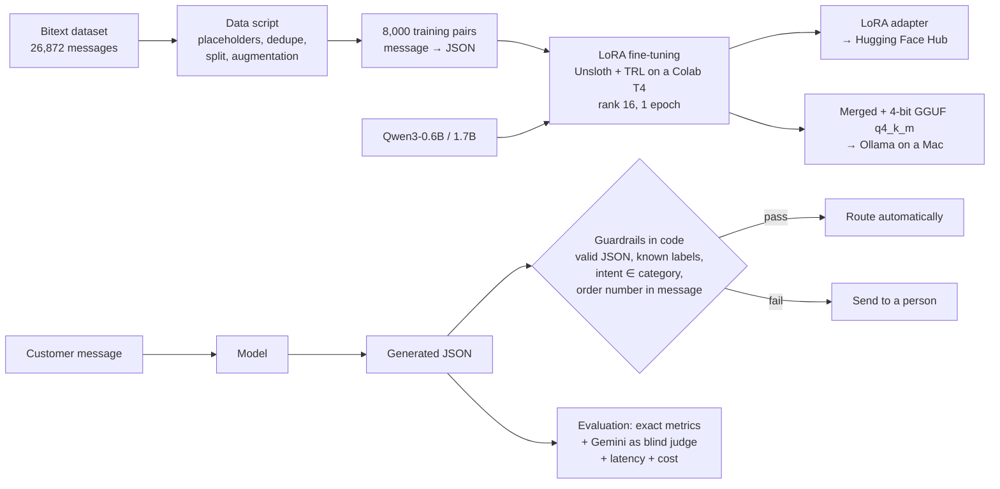

# Small fine-tuned LLM vs. large API model — support-ticket triage

**Question:** for a narrow, structured task, can a small open LLM fine-tuned with LoRA match a large
hosted model (Gemini Flash), and at what cost, latency and reliability?

**Task:** read a customer-support message and write a JSON routing record:

```json
{"category": "REFUND", "intent": "get_refund", "order_number": "PX300127"}
```

11 categories, 27 intents, and an order number that must be copied exactly (or `null`).
Data: the public [Bitext customer-support dataset](https://huggingface.co/datasets/bitext/Bitext-customer-support-llm-chatbot-training-dataset)
(26,872 messages), plus 60 hand-written messages in a different style.

| | |
|---|---|
| Fine-tuned model (LoRA adapter) | [LazareA/qwen3-0.6b-support-triage-lora](https://huggingface.co/LazareA/qwen3-0.6b-support-triage-lora) |
| 4-bit GGUF for Ollama / llama.cpp | [LazareA/qwen3-0.6b-support-triage-GGUF](https://huggingface.co/LazareA/qwen3-0.6b-support-triage-GGUF) |
| Technical report (EN) | [report/report.pdf](report/report.pdf) · [Markdown](report/report.md) |
| Colab training notebook (Unsloth) | [notebooks/finetune_qwen3_unsloth.ipynb](notebooks/finetune_qwen3_unsloth.ipynb) [](https://colab.research.google.com/github/lazareaya/llm-finetune-vs-api/blob/main/notebooks/finetune_qwen3_unsloth.ipynb) |

## Results

Every system is scored by the same code on the same messages (`evals/run.py`), graded blind by an
LLM judge (`evals/judge.py`), and priced per 1,000 requests (`evals/final_table.py`).
All raw outputs are in [`evals/outputs/`](evals/outputs) and all numbers in [`evals/report.json`](evals/report.json).

<!-- RESULTS:START -->
**Held-out test set** (public dataset messages never used for training)

| System | Size | Whole record correct | Valid JSON | Judge grade (1-5) | Latency per message | Cost per 1,000 requests |
|---|---|---|---|---|---|---|
| SmolLM2-135M, instructions only | 135M | 0.0% (n=100) | 0.0% | 1.00 (n=100) | 480 ms (CPU, batched) | $0 API (+ ~$0.0067 compute) |
| SmolLM2-135M, instructions + 8 examples | 135M | 8.0% (n=100) | 100.0% | 2.99 (n=100) | 865 ms (CPU, batched) | $0 API (+ ~$0.0120 compute) |
| SmolLM2-135M fine-tuned (LoRA, original repo) | 135M | 97.4% (n=1000) | 99.9% | 4.98 (n=100) | 766 ms (CPU, 1 request) | $0 API (+ ~$0.0106 compute) |
| Qwen3-0.6B, instructions only | 0.6B | 12.0% (n=100) | 100.0% | 3.03 (n=100) | 143 ms (T4 GPU, batched) | $0 API (+ ~$0.0140 compute) |
| **Qwen3-0.6B fine-tuned (LoRA, Unsloth)** | 0.6B | 99.7% (n=1000) | 100.0% | 5.00 (n=100) | 837 ms (T4 GPU, 16-bit, 1 request) | $0 API (+ ~$0.0814 compute) |
| **Qwen3-0.6B fine-tuned, 4-bit GGUF in Ollama (Mac)** | 0.6B (Q4_K_M, 396 MB) | 99.5% (n=200) | 100.0% | - | 203 ms (Mac 8 GB, Apple GPU (Metal), Ollama 4-bit, 1 request); 222 ms CPU only | $0 API (+ ~$0.0028 compute) |
| TF-IDF + logistic regression + regex | - | 95.5% (n=1000) | 100.0% | 4.95 (n=100) | 0.01 ms (CPU) | $0 API (+ ~$0.0000 compute) |
| Gemini 3 Flash (API), instructions only | large (undisclosed) | 94.0% (n=200) | 100.0% | 4.94 (n=100) | 2227 ms (API, free tier, 1 request) | $1.01 API (252 in + 294 out tokens/req) |

**Hand-written set** (60 messages in a different style, `evals/challenge.jsonl`)

| System | Whole record correct | Intent correct | Order number found | Valid JSON |
|---|---|---|---|---|
| SmolLM2-135M, instructions only | 0.0% | 0.0% | 0.0% | 0.0% |
| SmolLM2-135M, instructions + 8 examples | 1.7% | 16.7% | 6.2% | 98.3% |
| SmolLM2-135M fine-tuned (LoRA, original repo) | 65.0% | 66.7% | 93.8% | 100.0% |
| Qwen3-0.6B, instructions only | 13.3% | 26.7% | 68.8% | 100.0% |
| **Qwen3-0.6B fine-tuned (LoRA, Unsloth)** | 81.7% | 81.7% | 100.0% | 100.0% |
| **Qwen3-0.6B fine-tuned, 4-bit GGUF in Ollama (Mac)** | 83.3% | 83.3% | 100.0% | 100.0% |
| TF-IDF + logistic regression + regex | 71.7% | 73.3% | 100.0% | 100.0% |
| Gemini 3 Flash (API), instructions only | 88.3% | 98.3% | 68.8% | 100.0% |

**Judge vs exact metrics** (gemini-3.5-flash-lite, 100 test messages, 700 graded outputs): grade 4-5 agrees with an exactly correct record 94.6% of the time (Cohen's kappa 0.886); mean grade 4.98 when exact, 2.21 when wrong; 2 exact records graded 1-3, 36 wrong records graded 4-5.

Cost: gemini-3-flash-preview: $0.5 input / $3.0 output per 1M tokens (https://aistudio.google.com/docs/pricing, checked 2026-11-19; thinking tokens are billed as output). Local compute is estimated at $0.05/h for a small CPU machine or laptop share and $0.35/h for a cloud T4 GPU, times the measured time per message (one machine, no parallelism).
<!-- RESULTS:END -->

<!-- FINDINGS:START -->
**What the numbers say**

1. **Fine-tuning turns a model that cannot do the task into one that beats the API on the task it was
   trained for.** Untouched, Qwen3-0.6B gets 12% of records right. After a 2.5-minute LoRA run on a free T4,
   it gets **99.7%** on 1,000 held-out messages. On the same 200 messages, it scores **99.5% against 94.0% for
   Gemini 3 Flash**, ahead of the 135M model (98.0%) and the classic classifier (96.5%).
2. **On unfamiliar wording, the large model still understands intent better.** On the 60 hand-written
   messages, Gemini gets 98.3% of intents right against 81.7% for the fine-tuned Qwen3. Its whole-record score
   (88.3%) is lower because it often drops the `#` from order numbers like `#48213`. With a lenient comparison
   that ignores the `#`, Gemini reaches 96.7%. The fine-tuned model copies the number exactly every time
   (100%), because it learned the exact output format.
3. **4-bit quantisation costs no accuracy here.** The q4_k_m GGUF (396 MB) scores 99.5% on the test sample and
   83.3% on the hand-written set (16-bit: 99.5% and 81.7%). Served by Ollama on an 8 GB MacBook, it answers
   in **203 ms** per request (222 ms on the CPU alone), against **2.2 s** for Gemini on the free tier.
4. **Cost.** Gemini 3 Flash costs about **$1.01 per 1,000 requests**: 252 input and 294 output tokens per
   request, most of the output being hidden thinking. The local model costs $0 in API fees and about $0.003
   of laptop time per 1,000 requests. At 1 million requests a month, that is about $1,000 against a few dollars
   of machine time, and the customer messages never leave the company.
5. **The LLM judge agrees with exact match (Cohen's kappa 0.89), but it is lenient on format.** It gives 4/5
   to records that use invented labels such as `"feedback"` or `"terminate_account"`. They mean the right
   thing, but routing code cannot use them. 34 of its 38 disagreements with exact match are records
   like these from the untrained models; 2 are Gemini records without the `#`; the fine-tuned models have none. A judge measures meaning; the guardrails and exact metrics measure whether the output can be
   used. Both are needed.
<!-- FINDINGS:END -->

## How it works



- **LoRA**: the base model is frozen; rank-16 adapters on the attention projections are trained
  (0.76% of Qwen3-0.6B's weights). Only the JSON answer carries a loss, never the customer message.
- **Guardrails**: output is parsed and validated (Pydantic), labels must be on the approved list,
  the intent must belong to the category, and the order number must literally appear in the message.
  Anything that fails goes to a human.
- **Hosted baseline**: Gemini Flash through its OpenAI-compatible endpoint, with the full label list
  in the prompt and JSON mode; token usage (including thinking tokens) is recorded for the cost column.
- **LLM-as-a-judge**: for each message, Gemini sees the reference record and all systems' outputs under
  shuffled anonymous letters and grades each 1-5; the grades are then compared with the exact metrics
  (agreement, Cohen's kappa, disagreement cases).
- **Quantisation & serving**: the merged model is exported to GGUF q4_k_m and served by Ollama on a
  laptop; latency is measured one request at a time.

## What I added (compared with the original project)

The starting point ([BelAnas/small-llm-lora-finetune](https://github.com/BelAnas/small-llm-lora-finetune),
original README kept in [docs/original_README.md](docs/original_README.md)) fine-tuned a 135M model on a CPU
and compared it with prompting and a classic classifier. In this fork I:

1. **Fine-tuned a real LLM on GPU**: Qwen3-0.6B (and 1.7B) with **Unsloth + TRL + PEFT** on a Colab T4
   ([notebook](notebooks/finetune_qwen3_unsloth.ipynb)), adapter published on the Hugging Face Hub.
   The repo's own training code also runs on CUDA / Apple GPUs now (device selection, mixed precision,
   gradient accumulation).
2. **Measured a large hosted model**: Gemini Flash via the OpenAI-compatible API (retries for free-tier rate
   limits, response cache, thinking-token accounting).
3. **Added an LLM judge** (`evals/judge.py`): blind, order-shuffled, one call per message for all
   systems, and an agreement analysis against the exact metrics.
4. **Added cost and latency analysis** (`evals/final_table.py`): cost per 1,000 requests from measured
   tokens and list prices, compute estimate for local models, per-request latency.
5. **Quantised the model to 4 bits** (GGUF q4_k_m) and **served it locally with Ollama**
   (`OllamaProvider`, `scripts/ollama_create.sh`), with latency measured on a Mac.
6. **Error analysis** by error type (`evals/errors.py`) and a **technical report** ([report/](report/)).
7. Tests for all of the above (`tests/test_additions.py`, 62 offline tests in total).

## Reproduce

```bash
uv venv --python 3.11 && source .venv/bin/activate && uv pip install -r requirements.txt
pytest -q                                                    # 62 offline tests
python -m triage.cli data                                    # dataset → data/{train,val,test}.jsonl

# Local baselines (CPU)
python -m evals.run --systems classic lora mock --set test
python -m evals.run --systems base-prompt base-examples --set test --limit 100

# Qwen3 fine-tuning + evaluation + GGUF: open the notebook in Colab (T4), Run all, then:
python scripts/fetch_colab_results.py <hf-user>/qwen3-0.6b-support-triage-lora
bash scripts/ollama_create.sh qwen3-0.6b                     # registers the 4-bit model in Ollama
OLLAMA_MODEL=triage-qwen3-0.6b python -m evals.latency --system ollama
OLLAMA_MODEL=triage-qwen3-0.6b python -m evals.run --systems ollama --set test --limit 200

# Gemini comparison + LLM judge + final tables (free Google AI Studio key)
export GEMINI_API_KEY=...
bash scripts/run_gemini.sh
```

| Variable | Default | Meaning |
|---|---|---|
| `TRIAGE_PROVIDER` | `local` | API/CLI backend: `local`, `mock`, `openai` (any OpenAI-compatible API, e.g. Gemini), `ollama` |
| `TRIAGE_DEVICE` | auto | `cpu`, `cuda` or `mps` |
| `TRIAGE_ADAPTER_QWEN3_0_6B` | `adapters/qwen3-0.6b` | local folder or Hub repo id of the Qwen3 adapter |
| `OPENAI_API_KEY`, `OPENAI_BASE_URL`, `OPENAI_MODEL` | – | hosted model; for Gemini use `https://generativelanguage.googleapis.com/v1beta/openai/` |
| `OPENAI_REASONING_EFFORT`, `OPENAI_MAX_TOKENS` | –, 60 | thinking level and token cap for thinking models |
| `OLLAMA_MODEL`, `OLLAMA_URL` | `triage-qwen3-0.6b`, `http://127.0.0.1:11434` | local 4-bit model |

The API: `python -m triage.cli serve`, then `POST /route {"message": "..."}` (docs at `/docs`).

## Limits

See the [report](report/report.md) (section 6) for the full list. In short: the public dataset is
template-generated, so held-out scores flatter every trained system; the hand-written set is small (60)
and was written by the original author; there is no "none of these" label; one seed per configuration;
the judge is from the same family as one of the compared systems (Gemini), a known self-preference
risk; prices are list prices on the date checked.

## Credits

Based on [BelAnas/small-llm-lora-finetune](https://github.com/BelAnas/small-llm-lora-finetune) (MIT):
the task, data pipeline, guardrails, scorer, classic baseline and the 135M CPU run are theirs.
Training notebook adapted from [Unsloth's notebooks](https://github.com/unslothai/notebooks).
Base models: [Qwen3](https://huggingface.co/Qwen) (Apache 2.0), [SmolLM2-135M-Instruct](https://huggingface.co/HuggingFaceTB/SmolLM2-135M-Instruct) (Apache 2.0).
Data: Bitext customer-support dataset (CDLA-Sharing-1.0), downloaded by the data script and not stored here.
Licence of this repository: MIT, see [LICENSE](LICENSE).
